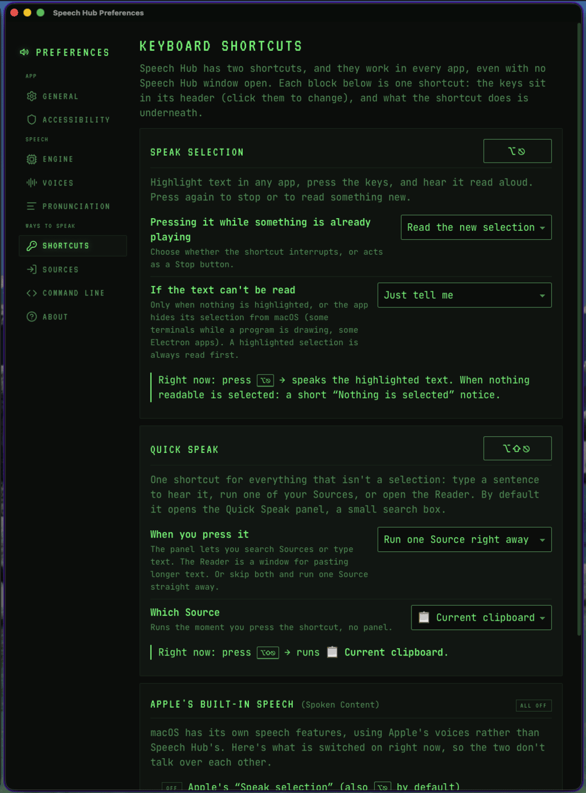
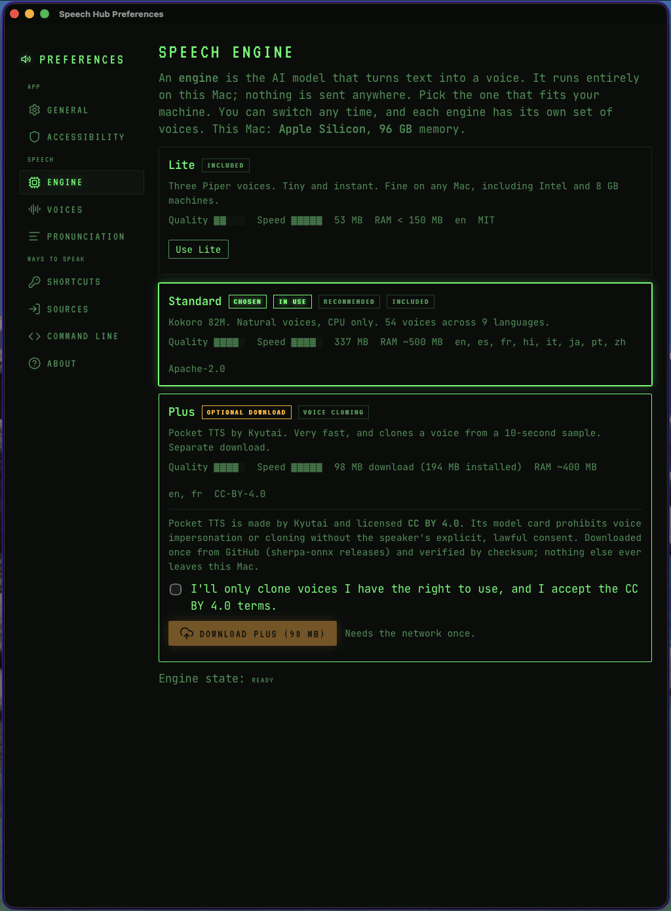
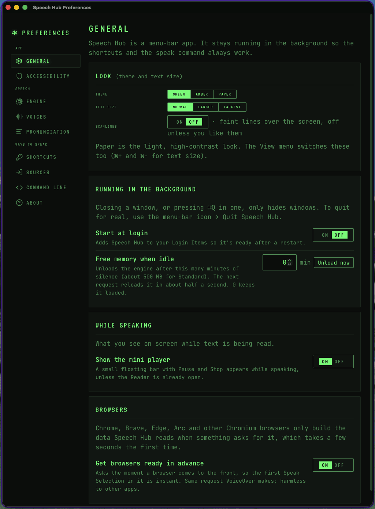
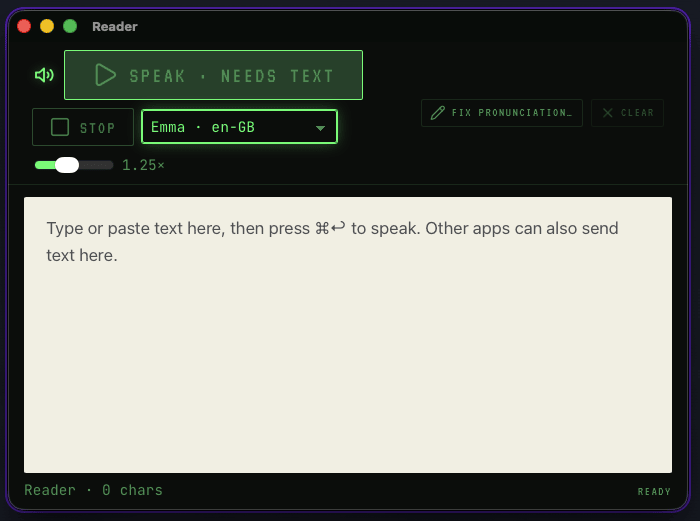

# Speech Hub

> ## Highlight text. Press ⌥⎋. Hear it read aloud in a natural voice.
> **A drop-in replacement for the Mac's built-in "Speak selection" feature**, with neural
> voices that run entirely on your machine.

**Version 0.1.0, pre-release.** Built for one person's daily use and tested against those use
cases on their own Apple Silicon Macs, nothing wider. Everything runs locally; nothing leaves the
machine unless you point a Source at a URL or approve a model download.

Local text-to-speech for macOS, delivered as a menu-bar app and a shared speech service.

**What sets it apart is that it hooks into whatever you already have.** Speech Hub is not a
reader with one text box. It is a voice layer that reaches out to your own scripts and that any
program can reach into:

- **Sources reach out.** A Source runs your own command or script, an Apple Shortcut, or an HTTP
  request, and speaks whatever comes back. A status script, a build log, a feed, a note file, the
  clipboard: each becomes a keystroke or a menu entry. Anything executable is approved once,
  explicitly, before it can run.
- **Everything reaches in.** The `speak` command, a Unix socket, `speechhub://` links, and the
  Services menu all feed the same voices, speed, and pronunciation rules, so a cron job, a
  Makefile, Raycast, or a Shortcut speaks exactly like a highlighted paragraph does.

<table>
<tr>
<td></td>
<td></td>
</tr>
<tr>
<td></td>
<td></td>
</tr>
</table>

Speech Hub is a replacement for Apple's built-in Spoken Content feature (System Settings →
Accessibility → Spoken Content, including the "Speak selection" shortcut) and for the `say`
command. It reads selected text aloud with a neural voice that runs entirely on the Mac, and it
exposes the same voices to every other tool on the system through a command-line interface, a
local socket, URL links, and the Services menu. Speech Hub converts text to speech. It does not
transcribe audio; Apple's Dictation remains the tool for that.

Apple Silicon (M1 or later), macOS 13 or newer. GPL-3.0-or-later.

## Contents

- [Overview](#overview)
- [Features](#features)
- [Terminology](#terminology)
- [Keyboard shortcuts](#keyboard-shortcuts)
- [Speech engines](#speech-engines)
- [Sources](#sources)
- [Command line and integrations](#command-line-and-integrations)
- [Privacy and security](#privacy-and-security)
- [Installation](#installation)
- [Building from source](#building-from-source)
- [Repository layout](#repository-layout)
- [Documentation](#documentation)
- [Project status](#project-status)
- [License](#license)

## Overview

Most text-to-speech utilities are readers: one window, one way in. Speech Hub is designed as a
single voice layer for the whole machine.

- One set of voices, one speaking speed, and one pronunciation dictionary apply everywhere:
  selected text, the Reader window, saved Sources, the `speak` command, Shortcuts, and links.
- Any program that can run a command or open a URL can speak through it. No model embedding, no
  runtime dependencies, no background server to manage.
- Everything runs on the CPU, offline. No account, no telemetry, no network traffic unless the
  user explicitly configures a URL Source or approves a model download.

## Features

**Speak Selection.** Select text in any application and press ⌥⎋. Pressing the shortcut again
stops playback (or restarts it, by preference). Selection capture uses the macOS Accessibility
API and supports the WebKit, Gecko, and Chromium accessibility dialects, so it works in Safari,
Firefox, Chrome, Brave, Mail, TextEdit, PDF viewers, and terminals. When no readable selection
exists, the configured fallback runs: a notice, the Quick Speak panel, or a Source such as
"Current clipboard".

**Quick Speak.** Press ⌥⇧⎋ for a command palette. Type text to speak it, run a Source, speak or
open the current selection, or open an empty Reader.

**Reader.** A window for longer text with play, pause, stop, speed, voice selection, progress, and
a "Fix pronunciation" action for any selected word.

**Mini player.** A compact floating control with pause and stop, shown while speech is playing.

**Sources.** User-defined inputs that supply text to the Hub: a saved snippet, a file, the output
of a command, the result of an Apple Shortcut, or a URL. Sources are created in a graphical
builder with templates, a test button, import and export, and an approval step for anything
executable.

**Pronunciation Studio.** A single dictionary of ordered substitution rules (literal or regular
expression) with live preview, applied to all speech regardless of where the text came from.

**Voices.** Two bundled engines with 57 voices across 9 languages, a default voice and speed,
per-Source overrides, and in-app previews. The optional Plus engine adds voice cloning from a
ten-second recording or a WAV file.

**Automation.** The `speak` command, a Unix-socket protocol, `speechhub://` links, two Services
menu items, and documented recipes for Apple Shortcuts, Raycast, Alfred, Keyboard Maestro,
BetterTouchTool, cron, and Makefiles.

**Menu-bar application.** No Dock icon, optional launch at login, and a five-step onboarding
wizard covering the single Accessibility permission the app requires.

## Terminology

| Term | Meaning |
|---|---|
| Speak Selection | The ⌥⎋ action: read the selected text in the frontmost application. |
| Quick Speak | The ⌥⇧⎋ panel: type text, run a Source, or act on the selection. |
| Source | A saved way to obtain text: file, command, Shortcut, URL, or snippet. |
| Reader | The window for listening to longer text with playback controls. |
| Mini player | The floating pause/stop control shown during playback. |
| Engine | A speech model that converts text to audio: Lite, Standard, or Plus. |
| Voice | One speaker within an engine. |
| Pronunciation rule | A substitution applied to text before synthesis. |

## Keyboard shortcuts

| Keys | Action |
|---|---|
| ⌥ ⎋ | Speak the selected text; press again to stop |
| ⌥ ⇧ ⎋ | Open the Quick Speak panel |

Both shortcuts are configurable in Preferences → Shortcuts. The pane detects a conflict with
Apple's "Speak selection" shortcut and offers to resolve it.

## Speech engines

Synthesis runs on the CPU through [sherpa-onnx](https://github.com/k2-fsa/sherpa-onnx). No
network access is required.

| Profile | Model | Size | First audio* | Notes |
|---|---|---|---|---|
| Lite | Piper, 3 voices, int8 | 53 MB | 380 ms | Bundled. Lowest memory. |
| Standard | Kokoro-82M fp32, 54 voices, 9 languages | 337 MB | 340 ms | Bundled. Default. |
| Plus | Pocket TTS (Kyutai) | 98 MB download | 261 ms | Voice cloning. CC-BY-4.0 with a consent notice. |

\* Measured on an Apple M3 Ultra, release build. Methodology and full results in
[docs/perf.md](docs/perf.md).

The Plus engine is never bundled. Preferences → Engines downloads it on request after presenting
its license, verifies the archive hash, and stores it under Application Support. Custom voices are
created from an in-app recording (microphone permission requested once) or from a WAV file, and
remain on the local machine.

Engines unload after a period of inactivity and reload on the next request, which adds roughly
one second to that request.

## Sources

A Source is a saved recipe for obtaining text. Each has a name, an icon, an optional voice and
speed, and an action: speak immediately or open in the Reader.

| Kind | Behavior | Approval required |
|---|---|---|
| Saved text | Speaks a fixed snippet. | No |
| File | Reads a `.txt` or `.md` file (1 MB limit). | No |
| Command | Runs a program with an argument list; standard output becomes the text. No shell unless enabled. | Yes |
| Apple Shortcut | Runs a Shortcut by name and reads its text result. | Yes |
| URL | HTTP GET. Plain text as-is, JSON via a field path, HTML reduced to text. | No |

Templates provide a working Source in one step: Current clipboard, Speak a file, Run a command,
Shortcut output, Fetch URL. Every Source runs with a 10-second timeout, a 1 MB output limit, and
a minimal environment. Imported Sources are untrusted until the user reviews the exact executable
and approves them.

Sources are available from the Quick Speak panel, the command line (`speak run <name>`), a
`speechhub://source/<name>` link (with confirmation), and as the Speak Selection fallback.
Details: [docs/sources.md](docs/sources.md).

## Command line and integrations

Preferences → Command Line installs `speak` into `~/.local/bin` without administrator rights. The
command accepts the common flags of Apple's `say`.

```bash
echo "Build finished" | speak          # standard input
speak "Hello, world"                   # positional text
speak -f notes.md                      # a file
speak -v af_heart -r 1.2 "Hello"       # voice and rate
pbpaste | speak --open                 # open in the Reader instead of speaking
speak run morning-briefing             # run a saved Source
speak palette                          # open Quick Speak
speak stop
speak status --json
speak voices --json
speak sources list
```

Exit codes: 0 success, 1 request error, 2 application unavailable, 3 permission or engine not
ready, 64 usage. Requests are limited to 1 MB. The application launches on demand.

Additional interfaces:

- **Unix socket** at `~/Library/Application Support/Speech Hub/run/hub.sock`. Length-prefixed
  JSON, restricted to the current user. Verbs: `speak`, `open`, `run_source`, `stop`, `pause`,
  `resume`, `status`, `list_voices`, `list_sources`, `palette`. There is no verb that executes
  arbitrary commands; only pre-approved Sources can run.
- **`speechhub://` links**: `open`, `palette`, `preferences`, `stop`, `speak?text=` (2 KB limit,
  rate-limited), and `source/<id-or-name>` (requires confirmation).
- **Services menu**: right-click selected text → Services → "Speak with Speech Hub" or "Open in
  Speech Hub Reader". Available in Chromium-based browsers as well as AppKit applications.
- **Apple Shortcuts, Raycast, Alfred, Keyboard Maestro, BetterTouchTool, cron**: recipes in
  [docs/shortcuts.md](docs/shortcuts.md).

Full reference: [docs/public-api.md](docs/public-api.md).

## Privacy and security

- No telemetry, accounts, or cloud services. Network access occurs only for a URL Source the user
  created or a model download the user approved.
- Submitted text is never written to logs. Log entries carry request identifiers and sizes only.
- All external input is treated as untrusted: deep links, imported Sources, socket requests, HTTP
  responses, and command output. Enforced controls include size limits, timeouts, schema
  validation, argument-list execution without a shell, a 0600 socket with a peer uid check, and
  rendering text strictly as text.
- One operating-system permission is required: Accessibility, to read the selection. Microphone
  access is requested only when recording a voice.
- The application is signed with the project's own long-lived certificate rather than an Apple
  Developer ID, so Accessibility grants survive updates. It is not notarized.

Trust boundaries and known limitations: [docs/security.md](docs/security.md).

## Installation

Requirements: an Apple Silicon Mac (M1 or later) running macOS 13 or newer. There is no Intel
build.

Homebrew (recommended; the cask also removes the quarantine flag, so no Gatekeeper step):

```bash
brew install --cask jeremym/tap/speech-hub     # also places `speak` on PATH
```

Homebrew 7 asks you to trust third-party casks; it records `jeremym/tap/speech-hub` as trusted
during the install.

Alternatively, download `SpeechHub-x.y.z.zip` from Releases and move the application to
/Applications. Because the app is not notarized, macOS blocks the first launch:

1. Open Speech Hub once and dismiss the "cannot be opened" dialog.
2. System Settings → Privacy & Security → Security → **Open Anyway** → confirm.

On macOS 15 and later, right-click → Open no longer bypasses Gatekeeper. Terminal alternative:

```bash
xattr -dr com.apple.quarantine "/Applications/Speech Hub.app"
```

### Verifying a download

```bash
shasum -a 256 SpeechHub-x.y.z.zip                 # must match the .sha256 asset on the release
codesign -d -r- "/Applications/Speech Hub.app"    # must print:
#   designated => identifier "com.jeremym.speechhub" and certificate leaf = H"b6025fb03507222832dcb4303acaa4ac194fbd67"
```

### First run

The onboarding wizard covers five steps: Accessibility permission, engine, voice, shortcuts, and
the optional `speak` command. Each step is also available later in Preferences.

## Building from source

Requirements: Rust (stable), Node 20 or later, pnpm, Xcode Command Line Tools, and the
`overtone-foundry-app-kit` repository checked out as a sibling folder (`package.json` links it
from `../overtone-foundry-app-kit`; run `pnpm build` there once).

```bash
pnpm install
scripts/fetch-models.sh        # download and hash-verify the bundled models (about 390 MB)
pnpm tauri dev                 # development build; also builds the `speak` sidecar
pnpm tauri build               # .app and .dmg in target/release/bundle
cargo test                     # Rust tests
pnpm test                      # frontend tests (Vitest)
pnpm typecheck                 # TypeScript type check
cargo run --release -p speech-hub --example bench -- standard   # first-audio latency benchmark
```

For a build intended for real use, run `scripts/install-local.sh`. It produces a release build,
signs it with the release identity, installs it to /Applications, and launches it. Debug builds
carry a hash-pinned signature, so each rebuild appears to macOS as a new application and loses
the Accessibility grant. Create the signing identity once with `scripts/create-release-cert.sh`.

Release packaging is documented in [docs/release.md](docs/release.md).

## Repository layout

```
speech-hub/
├── src/                      # React + TypeScript UI: Reader, Quick Speak, Source Builder,
│                             #   mini player, Voices, Pronunciation Studio, Preferences, Onboarding
├── src-tauri/                # Rust application: hub, engines, playback, sources, IPC, hotkeys,
│   │                         #   accessibility, settings, Services menu, URL scheme
│   ├── resources/models/     # bundled Lite and Standard models (fetched by script, not committed)
│   └── Info.plist            # Services menu and URL scheme declarations
├── crates/
│   ├── speechhub-protocol/   # request and response types shared by the app and the CLI
│   └── speechhub-cli/        # the `speak` command
├── scripts/                  # model fetch, CLI build, local install, release build, signing, tap update
├── docs/                     # reference documentation (see below)
├── PLAN.md                   # plan of record and milestone status
└── CLAUDE.md                 # project conventions
```

Stack: Tauri 2 (Rust, edition 2024), React 19, TypeScript, Vite, the Overtone Foundry app kit
for the look (see [docs/ui.md](docs/ui.md)), sherpa-onnx, cpal.

## Documentation

| Document | Contents |
|---|---|
| [docs/public-api.md](docs/public-api.md) | The `speak` command, socket protocol, `speechhub://` links |
| [docs/shortcuts.md](docs/shortcuts.md) | Apple Shortcuts, Services menu, launchers, shell automation |
| [docs/sources.md](docs/sources.md) | Source kinds, limits, approval model, recipes |
| [docs/security.md](docs/security.md) | Trust boundaries and permissions |
| [docs/architecture.md](docs/architecture.md) | Process model, modules, selection capture |
| [docs/perf.md](docs/perf.md) | Measured latency, real-time factor, memory |
| [docs/model-licenses.md](docs/model-licenses.md) | License of every bundled model and library |
| [docs/release.md](docs/release.md) | Signing and release runbook |
| [docs/testing.md](docs/testing.md) | Hands-on test matrix |
| [docs/decisions.md](docs/decisions.md) | Design decisions and their rationale |
| [docs/ui.md](docs/ui.md) | The look: screens mapped to the app kit, setup, upstream wishes |
| [PLAN.md](PLAN.md) | Plan of record, milestones, backlog |

## Project status

Version 0.1.0, pre-release. All features described above are implemented and verified on the
author's own hardware and workflows; other setups are untested. The first public release and the
Homebrew cask are pending. Current milestone status and the backlog are
tracked in [PLAN.md](PLAN.md).

## License

GPL-3.0-or-later. See [LICENSE](LICENSE). Bundled models and libraries carry their own licenses,
listed in [docs/model-licenses.md](docs/model-licenses.md).
